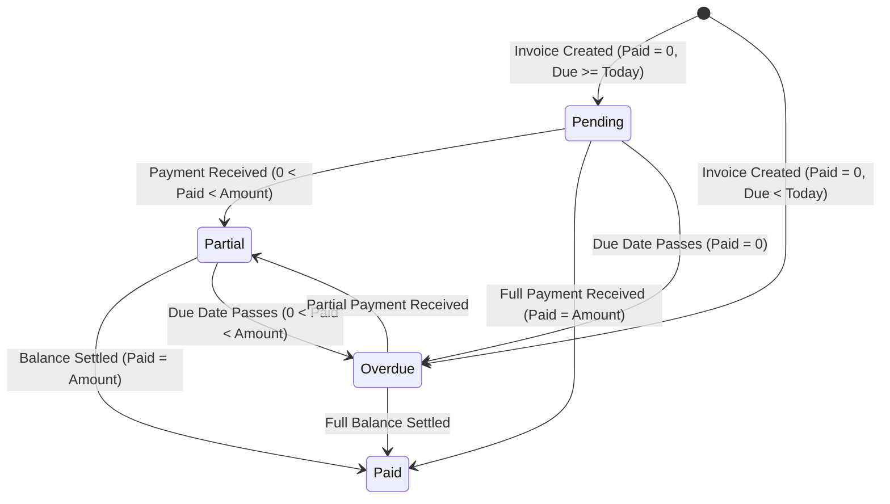

# Cliento — Financial Business Logic & Billing Rules

This specification establishes the authoritative rules governing financial calculations, invoice lifecycle transitions, payment validations, and monthly retainer billing workflows in **Cliento**.

---

## 1. Financial KPI Calculation Engine

All financial calculations are computed dynamically on the server from raw ledger records. Derived summary totals are **never** manually written or trusted from frontend submissions.

### 1.1. Core Mathematical Definitions

| KPI Metric | Exact Mathematical Formula | Data Source |
|---|---|---|
| **Total Invoiced (Expected)** | $\sum \text{invoices.amount}$ | `invoices` table for specified tenant & period |
| **Total Received** | $\sum \text{payments.amount}$ | `payments` table for specified tenant & period |
| **Total Pending (Outstanding)** | $\sum \max(0, \text{invoices.amount} - \text{paid\_amount})$ | Aggregated dynamically via invoice remaining balances |
| **Monthly Revenue** | $\sum \text{payments.amount}$ where $\text{payment\_date} \in [\text{Month Start}, \text{Month End}]$ | Cash-basis revenue received in target calendar month |
| **Total Expenses** | $\sum \text{expenses.amount}$ where $\text{date} \in [\text{Month Start}, \text{Month End}]$ | `expenses` table for specified period |
| **Net Income (Profit)** | $\text{Total Received} - \text{Total Expenses}$ | Cash-in minus operational cash-out |

> [!IMPORTANT]
> **No Double-Counting:** Revenue is counted on a strict cash basis from the `payments` table. An invoice billed at ₹10,000 with a partial payment of ₹4,000 contributes ₹4,000 to Total Received, while leaving ₹6,000 in Total Pending.

---

## 2. Invoice Lifecycle State Machine

Every invoice in Cliento evaluates to one of four mutually exclusive statuses, computed dynamically on the backend:



### State Evaluation Rules:

1. **`paid` (Settled):**
   $$\text{paid\_amount} \ge \text{amount} \quad (\text{remaining\_balance} = 0.00)$$
2. **`partial` (Partially Paid):**
   $$0 < \text{paid\_amount} < \text{amount} \quad \text{AND} \quad \text{due\_date} \ge \text{CURRENT\_DATE}$$
3. **`overdue` (Overdue Debt):**
   $$\text{paid\_amount} < \text{amount} \quad \text{AND} \quad \text{due\_date} < \text{CURRENT\_DATE}$$
4. **`pending` (Awaiting Settlement):**
   $$\text{paid\_amount} = 0.00 \quad \text{AND} \quad \text{due\_date} \ge \text{CURRENT\_DATE}$$

---

## 3. Payment Processing & Overpayment Prevention

Payments are recorded via `PaymentService::recordPayment` inside an atomic MySQL transaction.

### Strict Enforcement Rules:
1. **Zero / Negative Amount Prohibition:**
   Submissions where $\text{amount} \le 0$ are strictly rejected with an exception:
   `"Payment amount must be greater than zero."`
2. **Overpayment Prevention with Row Locking:**
   Before recording a payment, the invoice record is queried with `SELECT amount, status FROM invoices WHERE id = :id FOR UPDATE`. The remaining balance is calculated:
   $$\text{remaining\_balance} = \text{invoice.amount} - \sum \text{existing\_payments.amount}$$
   If $\text{payment\_amount} > \text{remaining\_balance}$, the transaction is aborted:
   `"Payment amount of ₹X exceeds the remaining balance of ₹Y"`
3. **Automatic Status Recalculation:**
   Immediately following payment insertion, the invoice's `status` column is updated based on the new cumulative total.
4. **Void / Rollback Support:**
   When a payment is deleted or voided via `PaymentService::deletePayment`, the invoice status is automatically recalculated backwards.

---

## 4. Idempotent Monthly Retainer Generation

Cliento provides automated batch billing for recurring retainer agreements.

### 4.1. Eligibility Criteria
A client receives an automatic invoice for billing month `YYYY-MM` if and only if:
1. Client belongs to authenticated tenant: `user_id = :uid`.
2. Client directory status is active: `status = 'active'`.
3. Retainer toggle is active: `retainer_status = 'active'`.
4. Client monthly retainer rate is positive: `monthly_amount > 0`.
5. No existing retainer invoice exists for this client and cycle:
   $$\text{COUNT}(*) = 0 \quad \text{where} \quad (\text{client\_id}, \text{billing\_month}, \text{charge\_type}) = (c.id, \text{YYYY-MM}, \text{'retainer'})$$

### 4.2. Database-Level Duplicate Defense
In addition to application logic, the database enforces idempotency through a compound unique key:
```sql
UNIQUE KEY uk_client_retainer_month (client_id, billing_month, charge_type)
```
Even if simultaneous HTTP calls or background cron jobs fire in parallel, the InnoDB storage engine rejects the second insert with a duplicate key violation (`SQLSTATE[23000]: 1062`).

### 4.3. Due Date Computation
The invoice due date is constructed using the client's configured `due_day` (between 1 and 28):
```php
$day = min(max((int)$client['due_day'], 1), 28);
$dueDate = sprintf('%s-%02d', $billingMonth, $day);
```

### 4.4. Historical Rate Preservation
When an agency modifies a client's monthly retainer rate (for example, renegotiating from ₹3,000/mo to ₹5,000/mo):
- All past invoices remain untouched at ₹3,000.
- All past payment ledgers and receipts remain untouched.
- Future monthly generation cycles produce invoices at the updated ₹5,000 rate.

---

## 5. Client Deactivation vs. Deletion Policy

To ensure complete accounting auditability:
1. If a client has **zero invoices and zero payments**, executing a delete operation safely hard-deletes the client row.
2. If a client has **one or more invoices or payments**, the backend automatically converts the delete request into a soft-deactivation (`status = 'inactive'`, `retainer_status = 'paused'`).
3. Historical invoices and payments remain preserved and visible in financial reports and the client's 360-degree dossier.
