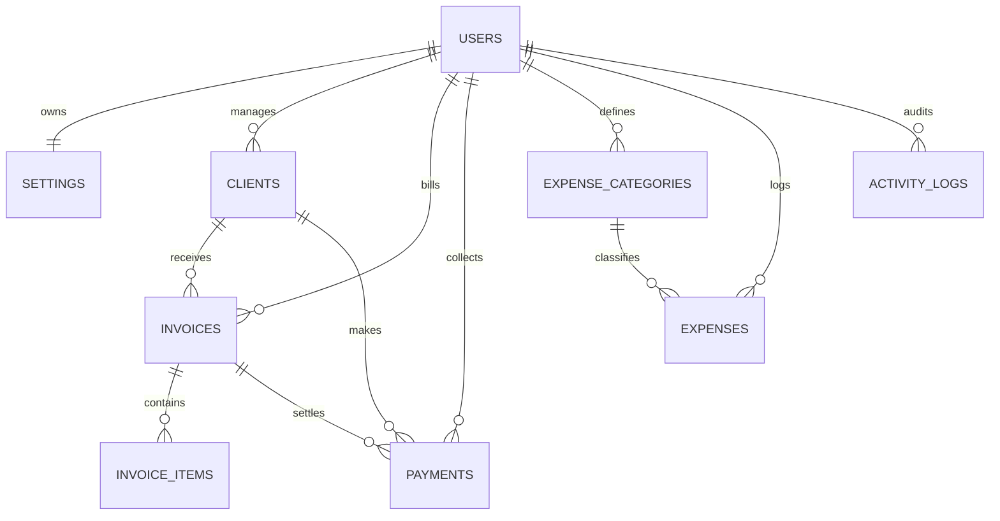

# Cliento — MySQL Database Architecture & Design Specification

This document details the normalized relational database architecture designed for **Cliento**, an enterprise-grade client management, monthly retainer billing, and payment tracking system.

---

## 1. Architectural Philosophy & Engine Standards

- **Engine:** MySQL 8.0+ `InnoDB` (ACID compliant, foreign key support, row-level locking with `FOR UPDATE`).
- **Character Set & Collation:** `utf8mb4` with `utf8mb4_unicode_ci` across all tables, columns, and connections to ensure support for multilingual names, special characters, and emojis.
- **Financial Precision:** Strict `DECIMAL(12, 2)` format for all monetary figures (`monthly_amount`, `amount`, `unit_price`, `total_amount`). `FLOAT` and `DOUBLE` are strictly prohibited to eliminate IEEE-754 floating-point rounding inaccuracies.
- **Temporal Integrity:** System timestamps use `DATETIME` defaults (`CURRENT_TIMESTAMP`, `ON UPDATE CURRENT_TIMESTAMP`). Financial operational dates use `DATE` (`YYYY-MM-DD`). Billing cycles use `VARCHAR(7)` (`YYYY-MM`).
- **Data Isolation (Multi-Tenancy):** Every tenant record belongs directly to a root record in `users` via `user_id`. Every analytical, transactional, and lookup query includes mandatory `WHERE user_id = :uid` scoping to ensure strict tenant boundary enforcement.

---

## 2. Entity-Relationship Diagram (ERD)

---

## 3. Relational Table Specifications

### 3.1. `users`
Root entity for user authentication, session authorization, and multi-tenant isolation.

| Column | Type | Nullable | Default | Description |
|---|---|---|---|---|
| `id` | `INT UNSIGNED` | NO | AUTO_INCREMENT | Primary Key |
| `name` | `VARCHAR(100)` | NO | None | Full legal or display name |
| `email` | `VARCHAR(191)` | NO | None | Unique login email identifier |
| `password_hash` | `VARCHAR(255)` | NO | None | BCRYPT password hash generated via `password_hash()` |
| `status` | `ENUM('active','inactive')` | NO | `'active'` | Account operational state |
| `created_at` | `DATETIME` | NO | `CURRENT_TIMESTAMP` | Account creation timestamp |
| `updated_at` | `DATETIME` | NO | `CURRENT_TIMESTAMP ON UPDATE CURRENT_TIMESTAMP` | Last profile update timestamp |

**Constraints & Indexes:**
- `PRIMARY KEY (id)`
- `UNIQUE KEY uk_users_email (email)`

---

### 3.2. `settings`
Stores agency/studio configuration and billing preferences (1:1 with `users`).

| Column | Type | Nullable | Default | Description |
|---|---|---|---|---|
| `id` | `INT UNSIGNED` | NO | AUTO_INCREMENT | Primary Key |
| `user_id` | `INT UNSIGNED` | NO | None | Foreign Key referencing `users(id)` |
| `business_name`| `VARCHAR(150)` | NO | `''` | Agency/studio business name |
| `phone` | `VARCHAR(30)` | NO | `''` | Business telephone / contact |
| `email` | `VARCHAR(191)` | NO | `''` | Public invoice billing contact email |
| `address` | `TEXT` | YES | `NULL` | Business postal address printed on invoices |
| `currency` | `VARCHAR(10)` | NO | `'INR'` | Standard display currency |
| `billing_preference` | `TINYINT UNSIGNED` | NO | `5` | Default monthly due day (1–28) |
| `invoice_prefix`| `VARCHAR(20)` | NO | `'INV-'` | Prefix for generated invoice numbers (e.g., `INV-2026-0001`) |
| `created_at` | `DATETIME` | NO | `CURRENT_TIMESTAMP` | Initial configuration timestamp |
| `updated_at` | `DATETIME` | NO | `CURRENT_TIMESTAMP ON UPDATE CURRENT_TIMESTAMP` | Last preferences modification |

**Constraints & Indexes:**
- `PRIMARY KEY (id)`
- `UNIQUE KEY uk_settings_user (user_id)`
- `FOREIGN KEY fk_settings_user (user_id) REFERENCES users(id) ON DELETE CASCADE`

---

### 3.3. `clients`
Client master records, monthly retainer contracts, and status tracking (1:M with `users`).

| Column | Type | Nullable | Default | Description |
|---|---|---|---|---|
| `id` | `INT UNSIGNED` | NO | AUTO_INCREMENT | Primary Key |
| `client_code` | `VARCHAR(50)` | YES | `NULL` | Legacy/migration code (e.g., `cli_apex`) |
| `user_id` | `INT UNSIGNED` | NO | None | Foreign Key referencing `users(id)` |
| `name` | `VARCHAR(150)` | NO | None | Client / Contact name |
| `company` | `VARCHAR(150)` | YES | `NULL` | Company or organization name |
| `phone` | `VARCHAR(50)` | YES | `NULL` | Primary phone contact |
| `email` | `VARCHAR(191)` | YES | `NULL` | Contact email address |
| `service` | `TEXT` | YES | `NULL` | Comma-separated or description of contracted services |
| `monthly_amount`| `DECIMAL(12, 2)`| NO | `0.00` | Agreed monthly retainer fee |
| `due_day` | `TINYINT UNSIGNED`| YES | `5` | Day of month billing due date (1–28) |
| `retainer_status`| `ENUM('active','paused')` | YES | `'active'` | Retainer auto-generation flag |
| `status` | `ENUM('active','inactive')` | NO | `'active'` | Client directory status (soft-delete toggle) |
| `joining_date` | `DATE` | NO | None | Client onboarding date (`YYYY-MM-DD`) |
| `notes` | `TEXT` | YES | `NULL` | Internal notes and documentation |
| `created_at` | `DATETIME` | NO | `CURRENT_TIMESTAMP` | Registration timestamp |
| `updated_at` | `DATETIME` | NO | `CURRENT_TIMESTAMP ON UPDATE CURRENT_TIMESTAMP` | Last updated timestamp |

**Constraints & Indexes:**
- `PRIMARY KEY (id)`
- `FOREIGN KEY fk_clients_user (user_id) REFERENCES users(id) ON DELETE CASCADE`
- `INDEX idx_clients_user_status (user_id, status)`
- `INDEX idx_clients_name (user_id, name)`
- `INDEX idx_clients_code (user_id, client_code)`

---

### 3.4. `invoices`
Invoices generated for monthly retainers and custom project engagements.

| Column | Type | Nullable | Default | Description |
|---|---|---|---|---|
| `id` | `INT UNSIGNED` | NO | AUTO_INCREMENT | Primary Key |
| `invoice_code` | `VARCHAR(50)` | YES | `NULL` | Legacy/migration code (e.g., `inv_xxx`) |
| `user_id` | `INT UNSIGNED` | NO | None | Foreign Key referencing `users(id)` |
| `client_id` | `INT UNSIGNED` | NO | None | Foreign Key referencing `clients(id)` |
| `invoice_number`| `VARCHAR(50)` | NO | None | Formatted invoice sequence (e.g., `INV-2026-0001`) |
| `service_name` | `VARCHAR(255)` | NO | `'Service'` | Service item or retainer title |
| `charge_type` | `ENUM('retainer','one_time','project_advance','custom_changes','standard')` | NO | `'standard'` | Billing classification |
| `notes` | `TEXT` | YES | `NULL` | Invoice notes / payment terms |
| `billing_month` | `VARCHAR(7)` | NO | None | Billing cycle period (`YYYY-MM`) |
| `amount` | `DECIMAL(12, 2)`| NO | None | Total invoice gross amount |
| `due_date` | `DATE` | NO | None | Payment due date (`YYYY-MM-DD`) |
| `status` | `ENUM('pending','partial','paid','overdue')` | NO | `'pending'` | Calculated payment settlement status |
| `created_at` | `DATETIME` | NO | `CURRENT_TIMESTAMP` | Invoice creation timestamp |
| `updated_at` | `DATETIME` | NO | `CURRENT_TIMESTAMP ON UPDATE CURRENT_TIMESTAMP` | Last status or balance recalculation |

**Constraints & Indexes:**
- `PRIMARY KEY (id)`
- `FOREIGN KEY fk_invoices_user (user_id) REFERENCES users(id) ON DELETE CASCADE`
- `FOREIGN KEY fk_invoices_client (client_id) REFERENCES clients(id) ON DELETE CASCADE`
- `UNIQUE KEY uk_user_invoice_number (user_id, invoice_number)` — Guarantees no two invoices share the same number per user.
- `UNIQUE KEY uk_client_retainer_month (client_id, billing_month, charge_type)` — Prevents duplicate retainer invoice creation for the same client in the same billing cycle.
- `INDEX idx_invoices_user_month (user_id, billing_month)`
- `INDEX idx_invoices_client_status (client_id, status)`
- `INDEX idx_invoices_due (user_id, due_date, status)`

---

### 3.5. `invoice_items`
Itemized line-item charges when an invoice requires multi-service or milestone breakdown.

| Column | Type | Nullable | Default | Description |
|---|---|---|---|---|
| `id` | `INT UNSIGNED` | NO | AUTO_INCREMENT | Primary Key |
| `invoice_id` | `INT UNSIGNED` | NO | None | Foreign Key referencing `invoices(id)` |
| `description` | `VARCHAR(255)` | NO | None | Line item service description |
| `quantity` | `DECIMAL(8, 2)` | NO | `1.00` | Units or hours billed |
| `unit_price` | `DECIMAL(12, 2)`| NO | `0.00` | Price per unit |
| `total_amount` | `DECIMAL(12, 2)`| NO | `0.00` | Calculated subtotal (`quantity * unit_price`) |
| `created_at` | `DATETIME` | NO | `CURRENT_TIMESTAMP` | Timestamp |

**Constraints & Indexes:**
- `PRIMARY KEY (id)`
- `FOREIGN KEY fk_invoice_items_invoice (invoice_id) REFERENCES invoices(id) ON DELETE CASCADE`
- `INDEX idx_items_invoice (invoice_id)`

---

### 3.6. `payments`
Immutable transaction ledger for all payments collected against invoices.

| Column | Type | Nullable | Default | Description |
|---|---|---|---|---|
| `id` | `INT UNSIGNED` | NO | AUTO_INCREMENT | Primary Key |
| `payment_code` | `VARCHAR(50)` | YES | `NULL` | Legacy/migration code (e.g., `pay_xxx`) |
| `user_id` | `INT UNSIGNED` | NO | None | Foreign Key referencing `users(id)` |
| `invoice_id` | `INT UNSIGNED` | NO | None | Foreign Key referencing `invoices(id)` |
| `client_id` | `INT UNSIGNED` | NO | None | Foreign Key referencing `clients(id)` |
| `amount` | `DECIMAL(12, 2)`| NO | None | Amount settled |
| `payment_date` | `DATE` | NO | None | Date payment received (`YYYY-MM-DD`) |
| `payment_method`| `VARCHAR(50)` | NO | `'Bank Transfer'` | Payment method (UPI, Bank Transfer, Card, Cash, etc.) |
| `notes` | `TEXT` | YES | `NULL` | Transaction remarks |
| `reference_number`| `VARCHAR(100)`| YES | `NULL` | External transaction UTR, cheque, or reference ID |
| `created_at` | `DATETIME` | NO | `CURRENT_TIMESTAMP` | Transaction recorded timestamp |

**Constraints & Indexes:**
- `PRIMARY KEY (id)`
- `FOREIGN KEY fk_payments_user (user_id) REFERENCES users(id) ON DELETE CASCADE`
- `FOREIGN KEY fk_payments_invoice (invoice_id) REFERENCES invoices(id) ON DELETE CASCADE`
- `FOREIGN KEY fk_payments_client (client_id) REFERENCES clients(id) ON DELETE CASCADE`
- `INDEX idx_payments_user_date (user_id, payment_date)`
- `INDEX idx_payments_invoice (invoice_id)`
- `INDEX idx_payments_client (client_id)`

---

### 3.7. `expense_categories`
Taxonomic classification for operational overhead and business expenditures.

| Column | Type | Nullable | Default | Description |
|---|---|---|---|---|
| `id` | `INT UNSIGNED` | NO | AUTO_INCREMENT | Primary Key |
| `user_id` | `INT UNSIGNED` | NO | None | Foreign Key referencing `users(id)` |
| `name` | `VARCHAR(100)` | NO | None | Category title (e.g., Software, Office, Marketing) |
| `is_default` | `TINYINT(1)` | NO | `0` | Flag indicating system-seeded category |
| `created_at` | `DATETIME` | NO | `CURRENT_TIMESTAMP` | Creation timestamp |

**Constraints & Indexes:**
- `PRIMARY KEY (id)`
- `FOREIGN KEY fk_expense_categories_user (user_id) REFERENCES users(id) ON DELETE CASCADE`
- `UNIQUE KEY uk_user_category_name (user_id, name)`

---

### 3.8. `expenses`
Business expenditure log tracking operating costs.

| Column | Type | Nullable | Default | Description |
|---|---|---|---|---|
| `id` | `INT UNSIGNED` | NO | AUTO_INCREMENT | Primary Key |
| `expense_code` | `VARCHAR(50)` | YES | `NULL` | Legacy/migration code (e.g., `exp_xxx`) |
| `user_id` | `INT UNSIGNED` | NO | None | Foreign Key referencing `users(id)` |
| `category_id` | `INT UNSIGNED` | YES | `NULL` | Foreign Key referencing `expense_categories(id)` |
| `title` | `VARCHAR(150)` | NO | None | Expense title/payee |
| `category` | `VARCHAR(100)` | NO | None | Category display name |
| `amount` | `DECIMAL(12, 2)`| NO | None | Expense amount |
| `date` | `DATE` | NO | None | Date incurred (`YYYY-MM-DD`) |
| `description` | `TEXT` | YES | `NULL` | Expense notes / vendor details |
| `created_at` | `DATETIME` | NO | `CURRENT_TIMESTAMP` | Created timestamp |
| `updated_at` | `DATETIME` | NO | `CURRENT_TIMESTAMP ON UPDATE CURRENT_TIMESTAMP` | Last updated timestamp |

**Constraints & Indexes:**
- `PRIMARY KEY (id)`
- `FOREIGN KEY fk_expenses_user (user_id) REFERENCES users(id) ON DELETE CASCADE`
- `FOREIGN KEY fk_expenses_category (category_id) REFERENCES expense_categories(id) ON DELETE SET NULL`
- `INDEX idx_expenses_user_date (user_id, date)`
- `INDEX idx_expenses_category (user_id, category)`

---

### 3.9. `activity_logs`
System operational audit trail logging state mutations for compliance and analytics.

| Column | Type | Nullable | Default | Description |
|---|---|---|---|---|
| `id` | `INT UNSIGNED` | NO | AUTO_INCREMENT | Primary Key |
| `user_id` | `INT UNSIGNED` | NO | None | Foreign Key referencing `users(id)` |
| `entity_type` | `VARCHAR(50)` | NO | None | Subject entity (`client`, `invoice`, `payment`, `expense`, `settings`) |
| `entity_id` | `INT UNSIGNED` | YES | `NULL` | Primary key of subject record |
| `action` | `VARCHAR(50)` | NO | None | Operation verb (`create`, `update`, `delete`, `record_payment`, `generate_monthly`) |
| `description` | `TEXT` | NO | None | Human-readable audit narrative |
| `ip_address` | `VARCHAR(45)` | YES | `NULL` | Client IP address (IPv4 / IPv6) |
| `created_at` | `DATETIME` | NO | `CURRENT_TIMESTAMP` | Log timestamp |

**Constraints & Indexes:**
- `PRIMARY KEY (id)`
- `FOREIGN KEY fk_activity_user (user_id) REFERENCES users(id) ON DELETE CASCADE`
- `INDEX idx_activity_user_date (user_id, created_at)`

---

## 4. Key Relational Integrity & Business Constraints

1. **Retainer Billing Idempotency**:
   The unique constraint `uk_client_retainer_month (client_id, billing_month, charge_type)` guarantees at the database storage engine layer that no client can receive two retainer invoices for the same cycle, regardless of concurrent web requests or worker executions.
2. **Sequential Invoice Numbers**:
   The unique constraint `uk_user_invoice_number (user_id, invoice_number)` guarantees unique invoice numbers across a tenant's portfolio.
3. **Safe Client Deletion via Soft-Deactivation**:
   To prevent breaking historical accounting or orphaning financial ledgers, the application enforces soft-deactivation (`status = 'inactive'`) if any invoice or payment history exists. Cascading delete is reserved strictly for complete tenant account purge.
4. **Row-Level Transaction Locking**:
   All balance updates and payment recordings execute inside an atomic InnoDB transaction using `SELECT ... FOR UPDATE` row locking to prevent race conditions and overpayment anomalies.
