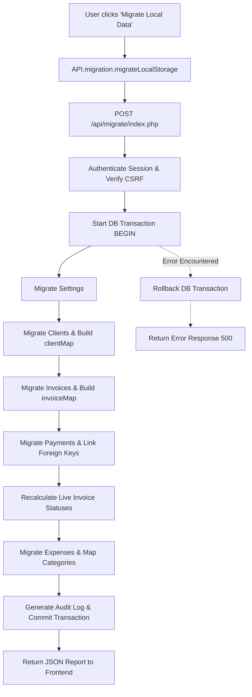

# Cliento — LocalStorage to MySQL Data Migration Strategy

This document describes the data migration pipeline that ingests offline browser `localStorage` records into the normalized MySQL 8.0+ relational schema.

---

## 1. Overview & Migration Principles

Existing deployments of Cliento store state inside the browser's `localStorage` across five JSON keys. The backend migration pipeline provides an automated, idempotent bridge that extracts these client-side collections, performs rigorous normalization, maps foreign keys, recalculates financial balances, and commits the data within an atomic MySQL transaction.

### Guiding Principles:
1. **Zero Data Loss:** Local browser data is **never deleted** during or after migration. It remains as an offline backup.
2. **Atomic Ingestion:** All records are inserted within a single MySQL `BEGIN TRANSACTION` ... `COMMIT` block. Any failure triggers a complete `ROLLBACK`.
3. **Primary Key Translation:** String-based client IDs (e.g., `cli_apex`, `inv_1730000000`) are mapped in memory to new `INT UNSIGNED AUTO_INCREMENT` database primary keys, while preserving the original identifier in `client_code`, `invoice_code`, and `payment_code` columns.
4. **Independent Financial Verification:** Invoice statuses (`pending`, `partial`, `paid`, `overdue`) are **never blindly copied** from the browser; they are re-derived on the server from the actual sum of mapped payment records and due dates.

---

## 2. Source Schema vs. Target MySQL Mapping

### 2.1. Clients (`cliento_clients` -> `clients`)

| LocalStorage Field | MySQL Column | Transformation / Rule |
|---|---|---|
| `id` (e.g. `'cli_apex'`) | `client_code` | Stored as legacy reference; mapped to `clients.id` |
| `name` | `name` | Required string, trimmed, sanitized |
| `company` | `company` | Optional string, nullable |
| `phone` | `phone` | Optional string |
| `email` | `email` | Validated email format or `NULL` |
| `service` | `service` | String or serialized comma-separated services |
| `monthlyAmount` | `monthly_amount` | Parsed float, stored as `DECIMAL(12, 2)` |
| `dueDay` | `due_day` | Clamped to integer `1–28` (default: `5`) |
| `retainerStatus` | `retainer_status` | Enum `'active'` or `'paused'` |
| `status` | `status` | Enum `'active'` or `'inactive'` |
| `joiningDate` | `joining_date` | Validated `YYYY-MM-DD` (fallback to today) |
| `notes` | `notes` | Optional text notes |

### 2.2. Invoices (`cliento_invoices` -> `invoices`)

| LocalStorage Field | MySQL Column | Transformation / Rule |
|---|---|---|
| `id` (e.g. `'inv_apex_nov26'`) | `invoice_code` | Stored as legacy reference |
| `clientId` | `client_id` | Translated to new MySQL `clients.id` via `$clientMap` |
| `invoiceNumber` | `invoice_number` | Verified unique per user; auto-generated if missing |
| `serviceName` | `service_name` | Default `'Service'` if empty |
| `chargeType` | `charge_type` | Mapped to `retainer`, `one_time`, `project_advance`, or `standard` |
| `billingMonth` | `billing_month` | Normalized to `YYYY-MM` |
| `amount` | `amount` | Parsed positive `DECIMAL(12, 2)` |
| `dueDate` | `due_date` | Validated `YYYY-MM-DD` |
| `status` | `status` | Re-derived dynamically from linked payment sum |

### 2.3. Payments (`cliento_payments` -> `payments`)

| LocalStorage Field | MySQL Column | Transformation / Rule |
|---|---|---|
| `id` (e.g. `'pay_apex_1'`) | `payment_code` | Stored as legacy reference |
| `invoiceId` | `invoice_id` | Translated to new MySQL `invoices.id` via `$invoiceMap` |
| `clientId` | `client_id` | Derived from mapped invoice or `$clientMap` |
| `amount` | `amount` | Parsed positive `DECIMAL(12, 2)` |
| `paymentDate` | `payment_date` | Validated `YYYY-MM-DD` |
| `paymentMethod` | `payment_method` | Default `'Bank Transfer'` if unspecified |
| `referenceNumber` | `reference_number`| External UTR or transaction ID |
| `notes` | `notes` | Optional transaction remarks |

### 2.4. Expenses (`cliento_expenses` -> `expenses`)

| LocalStorage Field | MySQL Column | Transformation / Rule |
|---|---|---|
| `id` (e.g. `'exp_1'`) | `expense_code` | Stored as legacy reference |
| `title` | `title` | Required string |
| `category` | `category` | String; automatically linked or inserted into `expense_categories` |
| `amount` | `amount` | Parsed positive `DECIMAL(12, 2)` |
| `date` | `date` | Validated `YYYY-MM-DD` |
| `description` | `description` | Optional text notes |

### 2.5. Settings (`cliento_settings` -> `settings`)

| LocalStorage Field | MySQL Column | Transformation / Rule |
|---|---|---|
| `businessName` | `business_name` | Agency name |
| `phone` | `phone` | Contact phone |
| `email` | `email` | Billing email |
| `address` | `address` | Office address |
| `billingPreference` | `billing_preference` | Default due day `1–28` |
| `invoicePrefix` | `invoice_prefix` | Standard prefix (e.g. `INV-`) |

---

## 3. Migration Pipeline Execution Flow



---

## 4. How to Trigger Data Migration

### Method A: One-Click Web Interface (Recommended)
1. Log in to Cliento at `http://localhost:8000/`.
2. Navigate to **Settings** from the sidebar navigation.
3. Locate the **MySQL Backend & Data Migration** section.
4. Click **Migrate Local Data to MySQL Database**.
5. The system presents a confirmation dialog with the count of records to be migrated. Click **Start Migration**.
6. A migration audit summary is rendered on the screen detailing the exact count of clients, invoices, payments, and expenses imported.

### Method B: REST API Direct Submission
Send a `POST` request to `/api/migrate/index.php` with the JSON payload exported from `Storage.exportBackupJSON()`:

```bash
curl -X POST http://localhost:8000/api/migrate/index.php \
  -H "Content-Type: application/json" \
  -H "X-CSRF-Token: <csrf_token>" \
  --cookie "cliento_session=<session_id>" \
  -d @cliento_backup.json
```

### Method C: Automated Test & CLI Verification
The test suite includes an automated test of the migration pipeline:
```bash
php tests/run_tests.php
```
Test group `[13] Testing LocalStorage Payload Migration Engine` verifies the migration of clients, invoices, payments, expenses, and settings.
